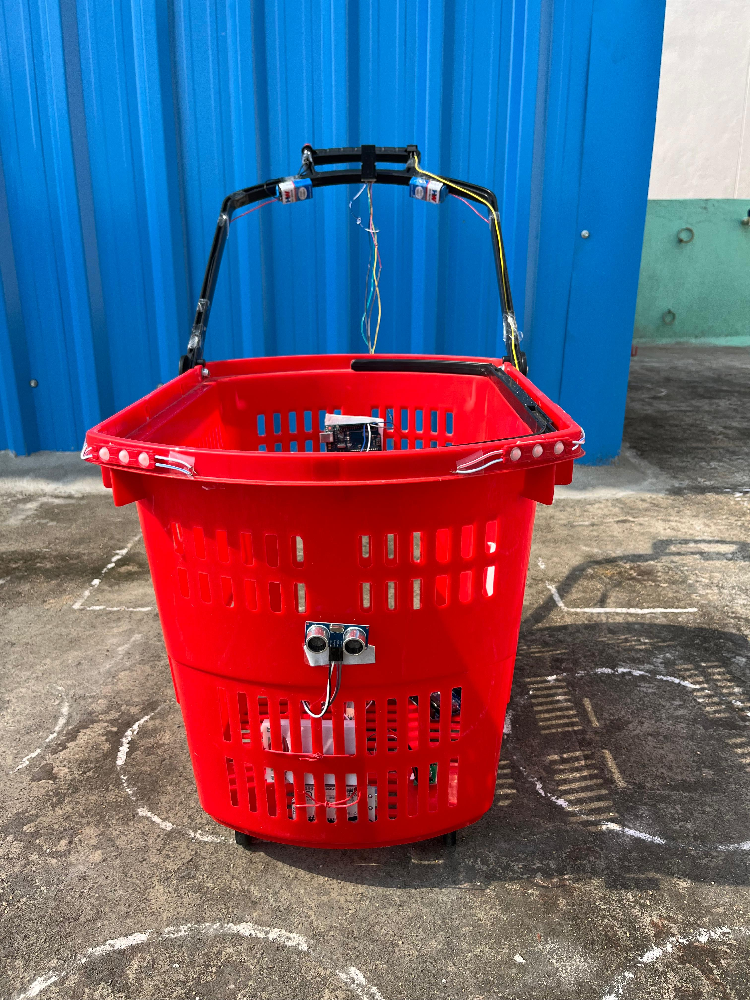
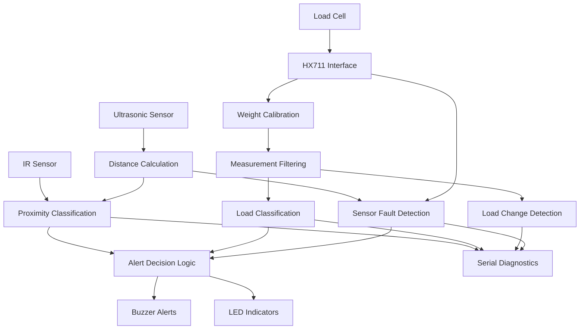
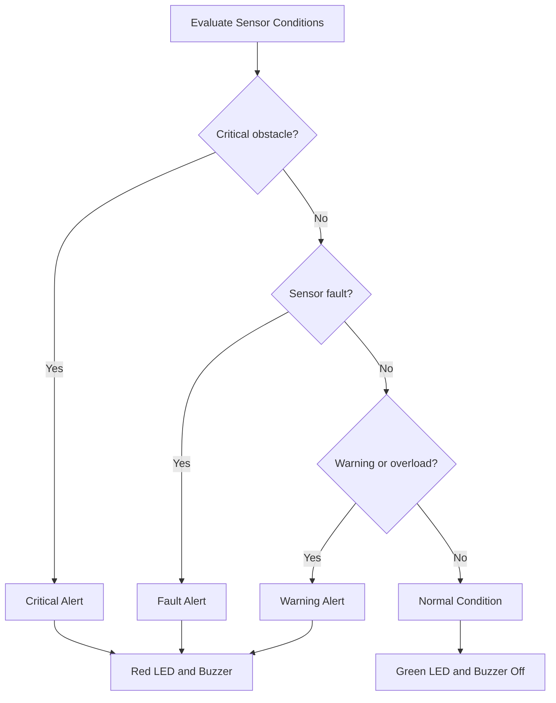
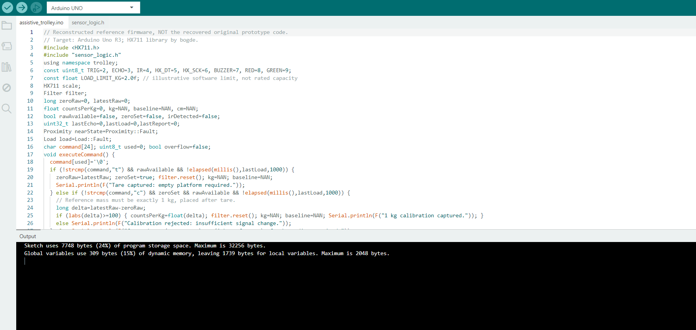
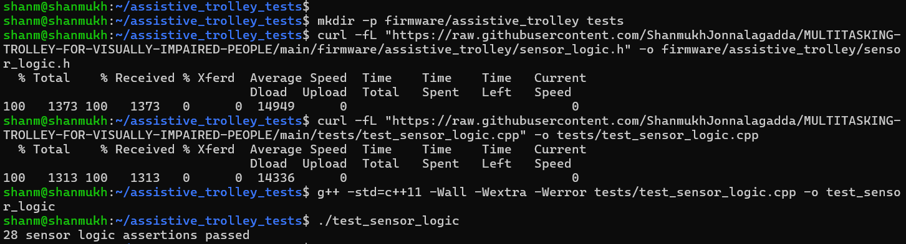
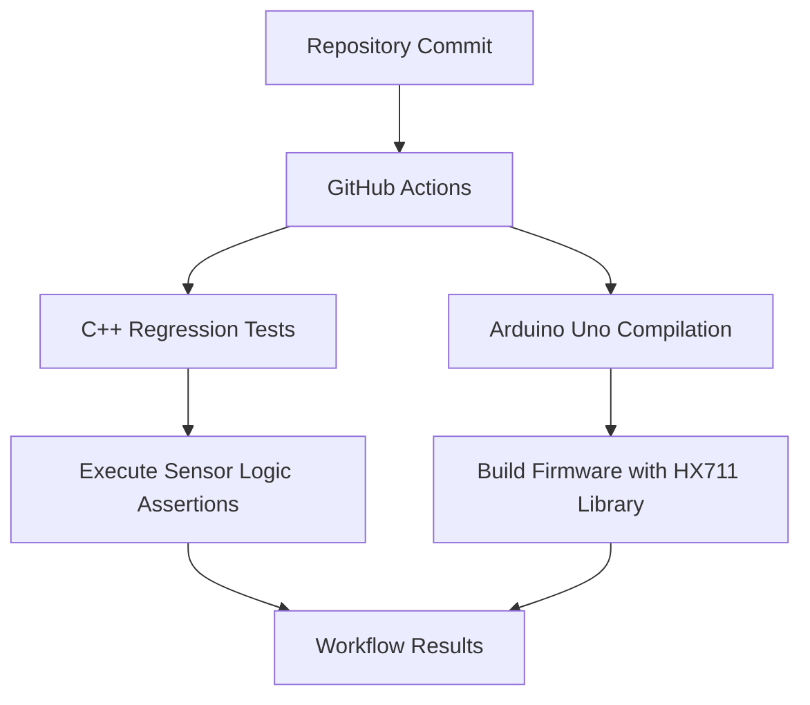

# Multitasking Trolley for Visually Impaired People

[](https://github.com/ShanmukhJonnalagadda/MULTITASKING-TROLLEY-FOR-VISUALLY-IMPAIRED-PEOPLE/actions/workflows/tests.yml)


An Arduino-based assistive shopping trolley project
exploring obstacle awareness, load measurement,
embedded sensor processing, and accessible user feedback.

The repository combines original physical prototype
documentation with a reconstructed embedded firmware
implementation, independent C++ sensor logic,
automated regression testing, and continuous integration.

## Project Highlights

| Engineering Metric | Result |
|---|---|
| Reference controller | Arduino Uno R3 |
| Local firmware compilation | Passed |
| Program storage utilization | 7748 bytes (24%) |
| Static SRAM utilization | 309 bytes (15%) |
| Automated C++ assertions | 28/28 passed |
| Continuous integration | Two successful verification jobs |
| Software and build requirements verified | 13 |
| Engineering documentation | Wiring, system design, validation |
| Original physical prototype evidence | Photograph and video |

**Project status:** Software reconstruction and build
verification completed. Physical hardware validation
of the reconstructed firmware remains pending.

## 1. Problem Statement

Shopping independently can present accessibility
challenges for people with visual impairments,
particularly when navigating unfamiliar environments,
identifying obstacles, and monitoring selected items.

This project explores the integration of multiple
assistive sensing technologies within a shopping
trolley to provide supplementary environmental
information and user feedback.

The system is intended as an educational engineering
prototype rather than a replacement for established
mobility aids.

## 2. Original Physical Prototype

The original trolley project explored the integration
of multiple sensing modules, an Arduino controller,
status indicators, and supporting circuitry.

### Prototype Photograph



### Prototype Walkthrough

[Watch the Original Prototype Video](images/Prototype_walkthrough.mp4)

The photograph and video document the original
physical assembly and electronic integration.

The original firmware is no longer available.
The software currently provided in this repository
is a newly reconstructed reference implementation.

The original prototype media does not demonstrate
operation of the reconstructed firmware.

## 3. Original Design and Reconstruction Scope

The original project reports describe a broader
assistive shopping system incorporating obstacle
sensing, load measurement, location support, visual
sensing, biometric identification, and warning outputs.

The reconstructed implementation concentrates on
testable embedded sensing and measurement algorithms.

| Subsystem | Original Project | Reconstructed Firmware |
|---|---|---|
| Arduino controller | Documented | Implemented |
| Ultrasonic obstacle detection | Visible in prototype | Implemented |
| IR obstacle detection | Documented | Implemented |
| Load-cell monitoring | Documented | Implemented |
| Audible feedback | Documented | Implemented |
| Status indicators | Prototype evidence | Implemented |
| GPS location support | Documented | Future extension |
| Camera-based sensing | Documented | Future extension |
| Biometric identification | Documented | Future extension |
| Navigation display | Documented | Future extension |
| Anti-theft support | Proposed | Load-change indication only |

Exact original sensor models and electrical connections
were not completely documented. The new firmware uses
an explicitly defined reference hardware configuration.

## 4. Implemented Features

- Ultrasonic echo-duration conversion.
- Threshold-based obstacle classification.
- Supplementary digital infrared obstacle sensing.
- HX711 load-cell interface.
- Serial-command-based tare calibration.
- Calibration using a known reference mass.
- Exponential moving average measurement filtering.
- Illustrative overload detection.
- Load-change event detection.
- Invalid measurement handling.
- Ultrasonic echo timeout handling.
- Load-cell data timeout handling.
- Prioritized audible alert logic.
- Red and green LED status indications.
- Serial diagnostic reporting.
- Timestamp-based sensor scheduling.
- Unsigned timer rollover handling.
- Independent and portable C++ sensor algorithms.
- Automated C++ regression assertions.
- GitHub Actions firmware compilation and testing.

## 5. System Architecture



The architecture separates hardware acquisition,
measurement processing, classification, output control,
and diagnostic reporting.

The independent sensor logic can be tested using a
desktop C++ compiler without connecting physical sensors.

## 6. Reference Hardware Configuration

| Component | Function |
|---|---|
| Arduino Uno R3 | Embedded controller |
| HC-SR04 ultrasonic sensor | Obstacle distance measurement |
| Digital IR sensor | Supplementary obstacle detection |
| Load cell | Mechanical load measurement |
| HX711 amplifier | Load-cell signal acquisition |
| Active buzzer module | Audible warning feedback |
| Red LED | Warning and fault indication |
| Green LED | Normal condition indication |
| Regulated power supply | Electrical power |

These components represent the proposed reconstructed
hardware configuration rather than verified original
prototype part numbers.

### Arduino Pin Assignments

| Arduino Pin | Function |
|---|---|
| D2 | Ultrasonic TRIG |
| D3 | Ultrasonic ECHO |
| D4 | Digital IR input |
| D5 | HX711 DOUT |
| D6 | HX711 SCK |
| D7 | Buzzer control |
| D8 | Red LED |
| D9 | Green LED |

Complete electrical connections and calibration
procedures are documented in:

[Hardware Wiring and Configuration](docs/wiring.md)

## 7. Engineering Algorithms

### Ultrasonic Distance Calculation

The distance to a detected object is estimated
from the round-trip echo duration.

Distance = (Speed of sound x Echo duration) / 2

Using a nominal speed of sound of 343 m/s:

Distance (cm) = Echo duration (us) x 0.01715

For example:

An echo duration of 1000 microseconds corresponds
to an estimated distance of 17.15 cm.

The firmware uses a bounded echo timeout of 25 ms.

### Obstacle Classification

| Condition | Classification |
|---|---|
| Valid distance from 2 to 20 cm | Critical |
| Valid distance above 20 cm and up to 50 cm | Warning |
| Valid distance above 50 cm and up to 400 cm, without IR detection | Clear |
| IR detection without critical ultrasonic distance | Warning |
| Invalid distance without IR detection | Fault |

The firmware independently retains an ultrasonic
range-fault flag even when IR detection is active.

These thresholds are illustrative software settings,
not validated safe stopping distances.

### Load-Cell Calibration

The calibrated mass is calculated using:

W = (R - R0) / K

Where:

- W is the estimated mass in kilograms.
- R is the current raw sensor reading.
- R0 is the zero-load reference.
- K is the calibration coefficient in counts/kg.

The firmware supports tare calibration and
calibration using a known 1 kg reference mass.

Positive and negative calibration coefficients
are supported.

### Measurement Filtering

An exponential moving average is used to smooth
the estimated weight.

Y[n] = alpha x X[n] + (1 - alpha) x Y[n-1]

The configured smoothing coefficient is 0.25.

For a previous filtered measurement of 4 kg
and a subsequent input of 8 kg:

Filtered measurement = (0.25 x 8) + (0.75 x 4)

Filtered measurement = 5 kg

Filtering reduces the influence of sudden changes
but introduces response lag.

### Load Classification

| Condition | Classification |
|---|---|
| Valid mass from -0.05 kg to below 2 kg | Normal |
| Valid mass at or above 2 kg | Overload |
| Invalid mass or mass below -0.05 kg | Fault |

The 2 kg overload threshold is an illustrative
software parameter, not the rated mechanical
capacity of the physical trolley.

### Load-Change Detection

The firmware detects a change when the absolute
difference between the filtered measurement and
stored baseline reaches or exceeds 0.2 kg.

This demonstrates load-monitoring logic that
could support future inventory functionality.

It does not establish that theft has occurred.

## 8. Alert Priority and User Feedback

The alert algorithm evaluates obstacle conditions,
load classification, and sensor faults.



### Audible Alert Configuration

| Alert | ON Duration | Period |
|---|---:|---:|
| Critical obstacle | 100 ms | 200 ms |
| Sensor fault | 100 ms | 1000 ms |
| Warning or overload | 150 ms | 600 ms |
| Normal | 0 ms | Not applicable |

The audible warning patterns have not been evaluated
for recognition, usability, or accessibility effectiveness.

## 9. Embedded Timing Configuration

| Parameter | Configuration |
|---|---:|
| Ultrasonic scheduling interval | 100 ms |
| Ultrasonic echo timeout | 25 ms |
| Load-cell data timeout | 1000 ms |
| Serial reporting interval | 1000 ms |
| Serial baud rate | 115200 |

The firmware uses timestamp-based scheduling and
unsigned elapsed-time calculations.

Ultrasonic acquisition includes a bounded blocking
operation, so the firmware is not completely
non-blocking.

Actual response latency and worst-case execution
time require physical measurement.

## 10. Firmware Organization

| Source File | Responsibility |
|---|---|
| assistive_trolley.ino | Hardware interfaces, sensor scheduling, calibration commands, alerts, and serial diagnostics |
| sensor_logic.h | Portable C++ measurement processing and classification functions |
| test_sensor_logic.cpp | Independent automated sensor logic verification |

### Independent Sensor Functions

| Function or Class | Purpose |
|---|---|
| distanceCm() | Convert echo duration to distance |
| proximity() | Classify obstacle conditions |
| weightKg() | Convert sensor readings into estimated mass |
| loadState() | Classify load conditions |
| elapsed() | Evaluate elapsed time with rollover handling |
| Filter | Apply exponential moving average filtering |
| changed() | Detect significant load changes |

## 11. Arduino Firmware Compilation

The reconstructed firmware was successfully
compiled for Arduino Uno using Arduino IDE.

| Memory Resource | Used | Available | Utilization |
|---|---:|---:|---:|
| Program storage | 7748 bytes | 32256 bytes | 24% |
| Static SRAM | 309 bytes | 2048 bytes | 15% |

### Remaining Memory Capacity

- Program storage: 24508 bytes.
- SRAM available for runtime use: 1739 bytes.

The compilation results establish that the
firmware fits within the selected target's
program storage and static memory capacity.

Runtime memory usage has not been measured.



## 12. Automated C++ Regression Testing

The independent sensor logic was compiled
and tested using G++ 15.2.0 under WSL Ubuntu.

### Test Results

| Functional Area | Assertions Passed |
|---|---:|
| Ultrasonic distance calculation | 2/2 |
| Obstacle and IR classification | 10/10 |
| Load-cell conversion | 3/3 |
| Load classification | 4/4 |
| Measurement filtering | 4/4 |
| Load-change detection | 3/3 |
| Timer rollover handling | 2/2 |
| Total | 28/28 |

### Observed Test Output

```text
28 sensor logic assertions passed
```



The test program was compiled using the C++11
standard with compiler warnings treated as errors.

All 28 defined assertions passed.

The assertion pass rate does not represent complete
source code coverage or physical hardware reliability.

## 13. Continuous Integration

GitHub Actions automatically verifies the software
on repository pushes and pull requests.

Manual workflow execution is also supported.



| Verification Job | Verified Result |
|---|---|
| C++ Regression Tests | PASS |
| Arduino Uno Firmware Compilation | PASS |

The workflow verifies both portable C++ logic
and complete Arduino firmware compilation.

[View Successful CI Workflow](https://github.com/ShanmukhJonnalagadda/MULTITASKING-TROLLEY-FOR-VISUALLY-IMPAIRED-PEOPLE/actions/runs/45758229708)

[View Latest GitHub Actions Results](https://github.com/ShanmukhJonnalagadda/MULTITASKING-TROLLEY-FOR-VISUALLY-IMPAIRED-PEOPLE/actions)

## 14. Technologies and Engineering Skills

| Technology | Application |
|---|---|
| Arduino C/C++ | Embedded firmware development |
| Arduino Uno | Reference embedded controller |
| Digital I/O | Sensor interfaces and output control |
| HX711 | Load-cell signal acquisition |
| Ultrasonic sensing | Time-of-flight distance calculation |
| Exponential moving average | Measurement filtering |
| Serial communication | Calibration and diagnostics |
| G++ | Desktop C++ compilation |
| C++ assertions | Automated algorithm verification |
| Arduino CLI | Automated firmware compilation |
| Git | Source code version control |
| GitHub Actions | Continuous integration |

Engineering concepts demonstrated include:

- Embedded systems programming.
- Sensor measurement processing.
- Signal acquisition and calibration.
- Threshold-based condition classification.
- Invalid measurement handling.
- Timestamp-based scheduling.
- Software architecture and modularity.
- Boundary condition testing.
- Embedded memory utilization analysis.
- Engineering verification and validation.

## 15. Repository Structure

```text
MULTITASKING-TROLLEY-FOR-VISUALLY-IMPAIRED-PEOPLE/
├── .github/
│   └── workflows/
│       └── tests.yml
├── docs/
│   ├── wiring.md
│   ├── system_design.md
│   └── validation.md
├── firmware/
│   └── assistive_trolley/
│       ├── assistive_trolley.ino
│       └── sensor_logic.h
├── images/
│   ├── Prototype_front.jpeg
│   ├── Prototype_walkthrough.mp4
│   ├── arduino_compilaton_results.png
│   └── cpp_test_results.png
├── tests/
│   └── test_sensor_logic.cpp
├── MULTITASKING TROLLEY FOR VISUALLY IMPAIRED PERSON.pdf
├── Multitasking cart for visually impaired people.pdf
├── LICENSE
└── README.md
```

## 16. Installation and Software Verification

### Clone the Repository

```bash
git clone https://github.com/ShanmukhJonnalagadda/MULTITASKING-TROLLEY-FOR-VISUALLY-IMPAIRED-PEOPLE.git
cd MULTITASKING-TROLLEY-FOR-VISUALLY-IMPAIRED-PEOPLE
```

### Arduino IDE Compilation

1. Install Arduino IDE.
2. Install the Arduino AVR Boards package.
3. Install the HX711 library by Bogdan Necula.
4. Open firmware/assistive_trolley/assistive_trolley.ino.
5. Keep sensor_logic.h in the same sketch folder.
6. Select Arduino Uno as the target board.
7. Click Verify to compile.

Physical Arduino hardware is not required
for firmware compilation.

### Desktop C++ Regression Tests

From the repository root:

```bash
g++ -std=c++11 -Wall -Wextra -Werror tests/test_sensor_logic.cpp -o test_sensor_logic
```

Execute the compiled test program:

```bash
./test_sensor_logic
```

Expected output:

```text
28 sensor logic assertions passed
```

### Reference Hardware Operation

For future physical testing, follow the
documented wiring and calibration procedures.

Open Serial Monitor at 115200 baud.

| Serial Command | Function |
|---|---|
| t | Capture empty-platform tare reference |
| c | Calibrate using a known 1 kg reference mass |

Commands require a newline terminator.

Calibration parameters are stored in volatile memory
and are not retained after a power cycle.

## 17. Engineering Documentation

| Document | Description |
|---|---|
| [Hardware Wiring](docs/wiring.md) | Reference components, pin assignments, electrical connections, and calibration |
| [System Design](docs/system_design.md) | Architecture, measurement algorithms, timing, fault handling, and engineering decisions |
| [Validation Report](docs/validation.md) | Compilation results, 28 test assertions, requirements verification, and proposed hardware tests |
| [Original Project Report](MULTITASKING%20TROLLEY%20FOR%20VISUALLY%20IMPAIRED%20PERSON.pdf) | Original objectives, architecture, and project methodology |
| [Technical Paper](Multitasking%20cart%20for%20visually%20impaired%20people.pdf) | Technical discussion of the documented assistive trolley concept |
| [Firmware Source](firmware/assistive_trolley/assistive_trolley.ino) | Reconstructed Arduino implementation |
| [Sensor Processing Logic](firmware/assistive_trolley/sensor_logic.h) | Independent C++ algorithms |
| [Regression Tests](tests/test_sensor_logic.cpp) | Automated algorithm verification |

## 18. Requirements Verification Summary

| Verification Category | Result |
|---|---:|
| Software and build requirements passed | 13 |
| Integration and hardware requirements not tested | 9 |
| Total documented requirements | 22 |

The software verification results are supported
by local compilation, automated assertions,
and successful continuous integration workflows.

The remaining requirements involve physical sensors,
complete system behavior, accessibility, and
power consumption.

## 19. System Limitations

- Original firmware is unavailable.
- Reconstructed firmware has not been physically deployed.
- Proposed electrical connections are not physically verified.
- Sensor measurement accuracy has not been quantified.
- IR sensor disconnection is not independently detected.
- Load-cell calibration requires a known reference mass.
- Calibration settings are not retained after power cycling.
- Measurement filtering introduces response lag.
- Complete alert behavior is not covered by the independent tests.
- Actual response latency has not been measured.
- GPS, camera, and biometric integration remain future work.
- Autonomous navigation and motor control are not implemented.
- Battery runtime has not been measured.
- Accessibility and usability have not been validated.

This project is an educational assistive technology
prototype. It is not a certified navigation or
personal safety device and must not replace
established mobility aids.

## 20. Future Development Opportunities

- Physical sensor calibration and accuracy evaluation.
- Hardware-in-the-loop testing.
- Persistent load-cell calibration storage.
- Improved sensor failure detection.
- Configurable measurement thresholds.
- Non-blocking ultrasonic acquisition.
- Automated testing of complete alert decisions.
- Accessible voice and haptic feedback.
- Biometric authentication integration.
- Camera-based product identification.
- Indoor localization using suitable technologies.
- Power consumption and battery runtime measurements.
- Supervised accessibility and usability evaluation.

## 21. Project Conclusion

The Multitasking Trolley project demonstrates the
application of embedded systems engineering to
an assistive technology problem.

The reconstructed firmware integrates sensor
measurement processing, calibration, filtering,
condition classification, fault handling,
and diagnostic feedback.

Successful Arduino compilation, 28 passing C++
assertions, and automated continuous integration
provide evidence of software build compatibility
and verification of the tested algorithms.

The original physical prototype and newly reconstructed
firmware are documented separately to preserve
engineering transparency.

## License

This project is licensed under the MIT License.

See the [LICENSE](LICENSE) file for details.

## Author

Sai Shanmukhnath Jonnalagadda

[GitHub Profile](https://github.com/ShanmukhJonnalagadda)
