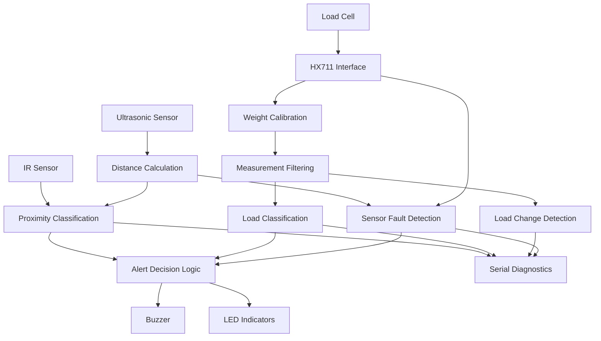
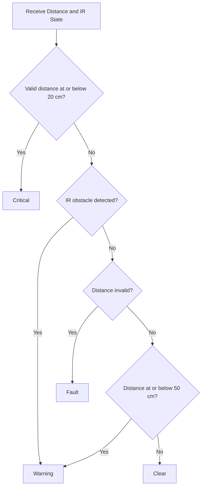
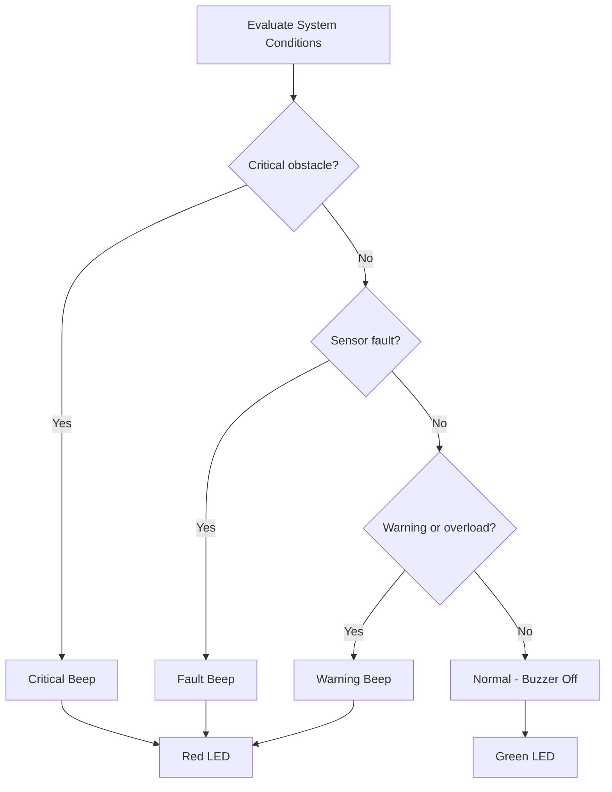
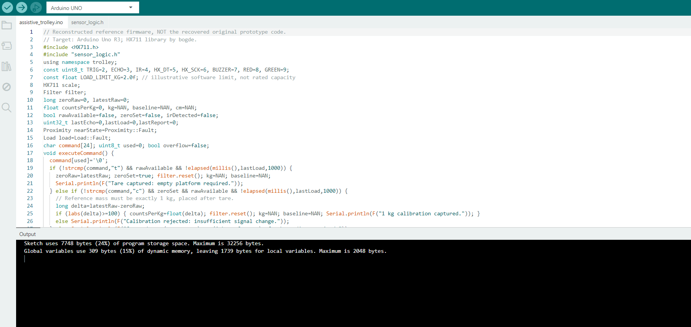
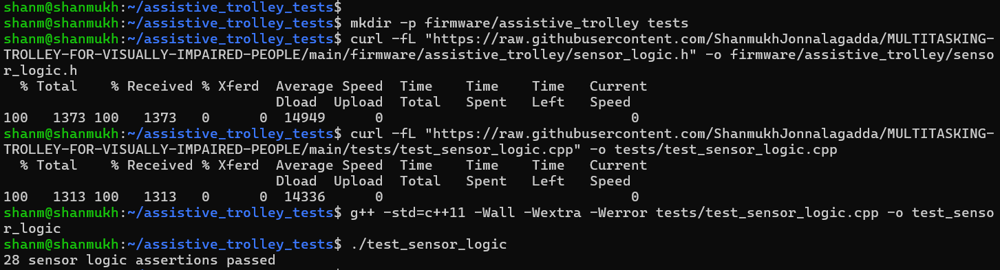
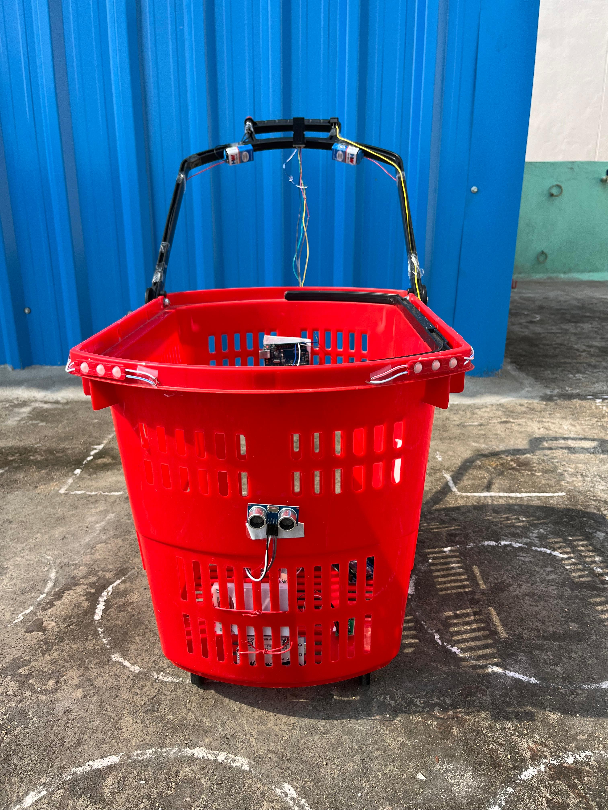

# System Design Documentation

## 1. System Overview

The Multitasking Trolley for Visually Impaired People
is an Arduino-based assistive technology project
designed to explore obstacle awareness, load monitoring,
and user feedback during shopping activities.

The original project architecture included obstacle
sensing, load measurement, GPS, camera-based sensing,
biometric identification, and warning outputs.

The original firmware is no longer available.

The software provided in this repository is a newly
developed reference implementation based on the
original project reports and recovered prototype
evidence.

The reconstruction focuses on ultrasonic and infrared
obstacle detection, load-cell measurement, condition
classification, fault handling, and user feedback.

## 2. Engineering Objectives

- Process ultrasonic distance measurements.
- Support supplementary infrared obstacle detection.
- Estimate weight using a calibrated load cell.
- Filter fluctuations in weight measurements.
- Detect abnormal proximity and load conditions.
- Identify invalid or unavailable sensor measurements.
- Generate audible and visual warning indications.
- Provide serial diagnostics for troubleshooting.
- Separate hardware interfaces from testable algorithms.
- Verify software behavior through automated testing.

## 3. Original Design and Reconstruction Scope

| Subsystem | Original Design | Reconstructed Firmware |
|---|---|---|
| Arduino controller | Documented | Implemented |
| IR obstacle sensing | Documented | Implemented |
| Ultrasonic sensing | Visible in prototype | Implemented |
| Load-cell monitoring | Documented | Implemented |
| GPS location support | Documented | Future extension |
| Camera sensing | Documented | Future extension |
| Biometric identification | Documented | Future extension |
| Audible feedback | Documented | Implemented |
| Status indicators | Prototype evidence | Implemented |
| Navigation display | Documented | Future extension |
| Anti-theft functionality | Proposed | Load-change indication only |

The original reports do not provide complete electrical
schematics, firmware source code, sensor models, or
quantitative experimental measurements.

The reconstructed firmware therefore uses explicitly
defined reference hardware and illustrative thresholds.

## 4. System Architecture

The system is organized into hardware acquisition,
measurement processing, classification, alert generation,
and diagnostic reporting.

This separation allows the measurement algorithms to
be tested independently of physical Arduino hardware.

## 5. Software Architecture

The reconstructed implementation contains three
primary source files.

| File | Responsibility |
|---|---|
| assistive_trolley.ino | Hardware interfacing, scheduling, calibration commands, alert generation, and serial reporting |
| sensor_logic.h | Independent measurement processing and condition classification algorithms |
| test_sensor_logic.cpp | Automated verification of sensor processing algorithms |

The Arduino sketch handles hardware-dependent operations.

The sensor logic header contains portable C++ functions
that can execute on both the Arduino target and a
desktop C++ compiler.

This architecture improves maintainability, testability,
and separation of responsibilities.

## 6. Ultrasonic Distance Measurement

The ultrasonic sensor measures the round-trip travel
time of an acoustic pulse.

The distance is calculated using:

d = (v x t) / 2

Where:

- d is the distance to the detected object.
- v is the nominal speed of sound.
- t is the measured round-trip travel time.

Using a nominal sound velocity of 343 m/s:

Distance (cm) = Echo duration (us) x 0.01715

For example, an echo duration of 1000 microseconds
corresponds to an estimated distance of 17.15 cm.

The firmware schedules ultrasonic measurements at
approximately 100 ms intervals.

An echo timeout of 25 ms limits the duration of
the pulse measurement operation.

A missing echo produces an invalid numeric value.

Measurements outside the accepted 2 cm to 400 cm
range are treated as range faults.

The calculation does not compensate for changes in
temperature, humidity, or acoustic reflection.

## 7. Obstacle Classification

The firmware combines ultrasonic distance information
with the digital IR detection state.

| Condition | Proximity Classification |
|---|---|
| Valid distance from 2 to 20 cm | Critical |
| IR obstacle detected, without critical ultrasonic distance | Warning |
| Valid distance above 20 cm and up to 50 cm | Warning |
| Valid distance above 50 cm and up to 400 cm, with no IR detection | Clear |
| Invalid distance and no IR detection | Fault |

A separate range-fault flag is maintained even
when IR detection produces a warning classification.

This prevents an invalid ultrasonic measurement from
being silently interpreted as normal operation.

### Classification Decision Flow

The Clear classification only indicates that the
configured sensor conditions did not trigger a warning.
It does not guarantee an obstacle-free environment.

The proximity thresholds are illustrative software
parameters rather than validated safe distances.

## 8. Load-Cell Measurement and Calibration

The load cell converts applied mechanical force into
an electrical signal.

The HX711 module provides signal amplification and
analog-to-digital conversion.

The firmware estimates mass using:

W = (R - R0) / K

Where:

- W is the estimated mass in kilograms.
- R is the current raw sensor reading.
- R0 is the zero-load reference reading.
- K is the calibration coefficient in counts per kilogram.

### Calibration Procedure

The serial command t captures the current raw
measurement as the zero-load reference.

The serial command c captures the calibration
coefficient using a known 1 kg reference mass.

The reference mass must be placed on the weighing
platform after tare calibration.

The firmware rejects calibration when the raw signal
change is below 100 counts in magnitude.

Both positive and negative calibration coefficients
are supported.

For example, using synthetic readings:

Zero reference = 1000 counts

Reference reading = 1500 counts

Reference mass = 1 kg

Calibration coefficient = 500 counts/kg

A subsequent raw measurement of 1750 counts produces:

Estimated mass = (1750 - 1000) / 500

Estimated mass = 1.5 kg

This example demonstrates the software calculation
and is not a physical measurement result.

Calibration values are stored in volatile memory
and must be re-established after power cycling.

## 9. Measurement Filtering

The firmware applies an exponential moving average
to weight measurements.

The filter equation is:

Y[n] = alpha x X[n] + (1 - alpha) x Y[n-1]

Where:

- X[n] is the current input measurement.
- Y[n] is the filtered output.
- Y[n-1] is the previous filtered output.
- alpha is the filter coefficient.

The configured coefficient is 0.25.

For example:

Previous filtered measurement = 4 kg

New measurement = 8 kg

Filtered result = (0.25 x 8) + (0.75 x 4)

Filtered result = 5 kg

The filter reduces the influence of sudden measurement
changes but introduces response lag.

The first valid measurement initializes the filter.

Invalid measurements reset its initialization state.

Physical noise reduction and response characteristics
have not been experimentally measured.

## 10. Load Classification

The firmware evaluates filtered weight measurements
using an illustrative overload threshold of 2 kg.

| Condition | Load Classification |
|---|---|
| Valid mass below 2 kg and at least -0.05 kg | Normal |
| Valid mass at or above 2 kg | Overload |
| Invalid measurement | Fault |
| Mass below -0.05 kg | Fault |

A small negative tolerance accommodates potential
zero-reference variation.

The 2 kg threshold is a demonstration parameter and
does not establish the mechanical load capacity of
the original trolley or the reference load cell.

The standalone classification function also rejects
invalid or non-positive overload limits.

## 11. Load-Change Detection

Changes in measured load are evaluated using:

Delta W = Wcurrent - Wbaseline

The configured change threshold is 0.2 kg.

A load-change event is generated when the absolute
difference between the filtered weight and stored
baseline reaches or exceeds the configured threshold.

After a detected event, the firmware updates the
baseline to the current filtered measurement.

Both increases and decreases can generate an event.

Load-change detection demonstrates item-monitoring
logic that could support a future inventory or
anti-theft system.

It does not identify individual products or establish
that theft has occurred.

## 12. Sensor Fault Handling

The system identifies several invalid operating
conditions.

| Fault Condition | Firmware Response |
|---|---|
| Missing ultrasonic echo | Invalid distance and range fault |
| Distance below 2 cm | Range fault |
| Distance above 400 cm | Range fault |
| Missing load-cell data | Load fault |
| Load-cell data stale for at least 1000 ms | Invalidate weight and reset filter |
| Missing calibration | Load fault |
| Invalid weight measurement | Load fault |
| Excessively negative weight | Load fault |

The firmware assumes an active-LOW IR sensor output.

The IR interface does not independently distinguish
a disconnected sensor from every possible valid
digital output condition.

Fault handling is therefore limited to the conditions
explicitly recognized by the implementation.

## 13. Alert Decision Logic

The firmware combines proximity classification,
load classification, and sensor fault information.

Alert priority is:

1. Critical obstacle condition
2. Sensor fault
3. General warning or overload
4. Normal operating condition

### Alert Selection Flow

### Audible Warning Patterns

| Alert | ON Duration | Period |
|---|---:|---:|
| Critical | 100 ms | 200 ms |
| Fault | 100 ms | 1000 ms |
| Warning | 150 ms | 600 ms |
| Normal | 0 ms | Not applicable |

The output patterns are generated using the system
millisecond counter.

The buzzer phase is based on system uptime rather
than restarting at the beginning of each alert.

The alert patterns have not been evaluated through
accessibility or human-subject testing.

## 14. Timing and Scheduling

The Arduino firmware uses timestamp-based scheduling
to coordinate periodic operations.

| Operation | Timing Configuration |
|---|---|
| Ultrasonic measurement scheduling | 100 ms |
| Ultrasonic echo timeout | 25 ms |
| Load-cell acquisition | When HX711 reports ready |
| Load-cell data timeout | 1000 ms |
| Serial diagnostic reporting | 1000 ms |
| IR detection | Each main-loop iteration |
| Alert evaluation | Each main-loop iteration |

The elapsed-time function uses unsigned integer
subtraction to support timer rollover.

The ultrasonic pulse measurement uses a bounded
blocking operation with a 25 ms timeout.

HX711 acquisition is attempted when the module
indicates readiness.

The firmware should not be described as completely
non-blocking or as a guaranteed real-time system.

Actual loop execution time, worst-case response
latency, and sensor sampling rates require physical
measurement.

## 15. Serial Communication and Diagnostics

The firmware initializes serial communication at
115200 baud.

Supported calibration commands are:

| Command | Function |
|---|---|
| t | Capture zero-load reference |
| c | Calibrate using a 1 kg reference mass |

Commands must be terminated by a newline.

The firmware uses a fixed-size command buffer and
rejects excessively long commands.

Command processing is limited to 16 incoming
characters per main-loop iteration.

Periodic diagnostic information includes:

- Ultrasonic distance
- IR detection state
- Estimated weight
- Proximity classification
- Load classification
- Ultrasonic range-fault flag

Serial diagnostics support troubleshooting and
future hardware verification.

## 16. Independent C++ Sensor Logic

| Function or Class | Responsibility |
|---|---|
| distanceCm() | Convert echo duration to distance |
| proximity() | Classify obstacle-related conditions |
| weightKg() | Convert raw load-cell values into mass |
| loadState() | Classify load conditions |
| elapsed() | Evaluate elapsed time with rollover handling |
| Filter | Apply exponential moving average filtering |
| changed() | Detect significant weight changes |

These functions are independent of Arduino-specific
digital I/O and serial communication.

This design allows the measurement algorithms
to be compiled and tested using a desktop compiler.

## 17. Software Verification

The reconstructed firmware was compiled successfully
for Arduino Uno using Arduino IDE.

### Compilation Results

| Parameter | Used | Available | Usage |
|---|---:|---:|---:|
| Flash memory | 7748 bytes | 32256 bytes | 24% |
| Static SRAM | 309 bytes | 2048 bytes | 15% |

Remaining static SRAM headroom is 1739 bytes.

The independent C++ test program was compiled using
G++ 15.2.0 under WSL Ubuntu with the C++11 standard.

The following compiler warning options were enabled:

- Wall
- Wextra
- Werror

All 28 automated sensor logic assertions passed.

GitHub Actions provides automated desktop C++
regression testing and Arduino Uno compilation.

These results establish software build compatibility
and verification of the tested algorithms.

They do not establish physical sensor performance.

## 18. Engineering Design Decisions

| Design Decision | Engineering Rationale |
|---|---|
| Arduino Uno reference target | Common embedded development platform |
| Separate sensor logic | Hardware-independent software testing |
| Ultrasonic and IR sensing | Supplementary obstacle information |
| HX711 interface | Load-cell signal conditioning |
| Reference-mass calibration | Conversion of raw sensor counts |
| Exponential moving average | Lightweight measurement smoothing |
| Threshold classification | Transparent decision logic |
| Distinct alert patterns | Differentiation of operating conditions |
| Timestamp-based scheduling | Reduced reliance on fixed delays |
| Serial diagnostics | Troubleshooting and observation |
| C++ regression assertions | Repeatable algorithm verification |
| GitHub Actions | Automated build and regression checks |

## 19. Physical Prototype Evidence

The following photograph documents the original
physical trolley assembly.

[Original Prototype Walkthrough](../images/Prototype_walkthrough.mp4)

The photograph and video establish the existence
and assembly of the earlier prototype.

They do not demonstrate operation of the newly
reconstructed firmware.

## 20. System Limitations

- Original firmware is unavailable.
- Reference wiring is not verified against the original assembly.
- Reconstructed firmware has not been physically tested.
- Sensor measurement accuracy has not been quantified.
- Ultrasonic sensing has limited object and angular coverage.
- IR sensor disconnection is not independently detected.
- Weight calibration requires a known reference mass.
- Calibration parameters are not stored permanently.
- Measurement filtering introduces response lag.
- Alert timing and response latency are not physically measured.
- GPS, camera, and biometric integration are not implemented.
- No autonomous navigation or motor control is implemented.
- Load-change detection does not establish theft.
- Automated tests do not exercise complete hardware behavior.
- Accessibility and user safety have not been validated.

The system is an educational assistive technology
prototype. It is not a certified navigation or
personal safety device and must not replace
established mobility aids.

## 21. Future Development Opportunities

- Physical ultrasonic and IR sensor calibration.
- Load-cell accuracy and repeatability measurements.
- Persistent storage of calibration parameters.
- Improved sensor health monitoring.
- Configurable proximity and load thresholds.
- Non-blocking ultrasonic measurement acquisition.
- Hardware-in-the-loop testing.
- Accessible voice and haptic feedback.
- Biometric authentication integration.
- Camera-based product identification.
- Indoor localization using suitable technologies.
- Power consumption and battery runtime evaluation.
- Accessibility evaluation with intended users under
  appropriate supervised testing conditions.

## 22. Supporting Documentation

- [Hardware Wiring and Configuration](wiring.md)
- [Arduino Firmware](../firmware/assistive_trolley/assistive_trolley.ino)
- [Independent Sensor Logic](../firmware/assistive_trolley/sensor_logic.h)
- [Automated C++ Tests](../tests/test_sensor_logic.cpp)
- [GitHub Actions Workflow](../.github/workflows/tests.yml)

## 23. Conclusion

The reconstructed Multitasking Trolley firmware
demonstrates embedded C/C++ development, sensor
measurement processing, calibration, filtering,
threshold classification, fault handling, and
software verification.

The architecture provides a testable foundation
for future development of assistive shopping
technologies.

The original prototype evidence, reconstructed
software, compilation results, and automated tests
are documented separately to maintain transparency
regarding the engineering work and its limitations.
