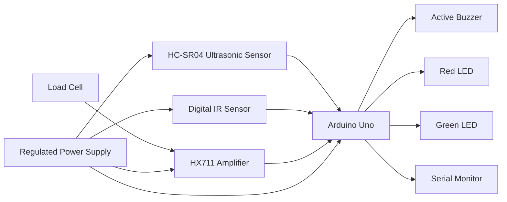

# Hardware Wiring and Configuration

## 1. Overview

This document describes the reference hardware configuration
for the reconstructed firmware of the Multitasking Trolley
for Visually Impaired People.

The original prototype incorporated multiple assistive
sensing technologies within a modified shopping trolley.

Since the original firmware and detailed electrical
schematics are unavailable, this wiring configuration
was developed specifically for the reconstructed
Arduino Uno implementation.

It does not represent a verified reproduction of the
original prototype wiring.

## 2. Hardware Requirements

| Component | Quantity | Purpose |
|---|---:|---|
| Arduino Uno R3 | 1 | Main embedded controller |
| HC-SR04 ultrasonic sensor | 1 | Obstacle distance measurement |
| Digital IR sensor module | 1 | Supplementary proximity detection |
| Load cell | 1 | Weight measurement |
| HX711 amplifier module | 1 | Load-cell signal acquisition |
| Active buzzer module | 1 | Audible warning feedback |
| Red LED | 1 | Warning and fault indication |
| Green LED | 1 | Normal operating indication |
| 330-ohm resistors | 2 | LED current limiting |
| Regulated power supply | As required | Hardware power |
| Breadboard and jumper wires | As required | Electrical connections |
| Reference mass of 1 kg | 1 | Load-cell calibration |

The component models are reference selections for the
reconstructed firmware. Exact original prototype models
were not fully documented.

The load-cell rated capacity must be selected according
to the intended mechanical load.

## 3. System Connection Architecture



The Arduino receives sensor measurements, executes
condition classification algorithms, and controls the
audible and visual output devices.

## 4. Arduino Pin Configuration

The following pin assignments match the reconstructed
firmware.

| Arduino Pin | Connected Component | Signal Direction |
|---|---|---|
| D2 | Ultrasonic TRIG | Output |
| D3 | Ultrasonic ECHO | Input |
| D4 | IR sensor OUT | Input |
| D5 | HX711 DOUT | Input |
| D6 | HX711 SCK | Output |
| D7 | Active buzzer control | Output |
| D8 | Red LED | Output |
| D9 | Green LED | Output |
| 5V | Compatible sensor supply | Power |
| GND | Common electrical ground | Ground |

Digital pins D0 and D1 are reserved for the Arduino Uno
hardware serial interface and are not used by the
sensor modules.

## 5. Ultrasonic Sensor Wiring

### HC-SR04 Connections

| Sensor Pin | Arduino Connection |
|---|---|
| VCC | 5V |
| TRIG | D2 |
| ECHO | D3 |
| GND | GND |

### Operating Principle

The Arduino generates a trigger pulse approximately
10 microseconds long.

The ultrasonic sensor transmits an acoustic signal
and provides an echo pulse corresponding to the
round-trip travel time.

Distance is calculated using:

Distance (cm) = Echo duration (us) x 0.01715

The conversion assumes a nominal speed of sound of
approximately 343 meters per second.

### Firmware Configuration

| Parameter | Value |
|---|---:|
| Trigger pulse | 10 us |
| Measurement scheduling interval | 100 ms |
| Echo timeout | 25 ms |
| Accepted minimum distance | 2 cm |
| Accepted maximum distance | 400 cm |

Missing echoes and measurements outside the accepted
range are treated as range faults.

The actual measurement range and accuracy depend on
sensor characteristics, environmental conditions,
object geometry, and mounting.

## 6. IR Sensor Wiring

| Sensor Pin | Arduino Connection |
|---|---|
| VCC | Compatible regulated supply |
| OUT | D4 |
| GND | GND |

The reconstructed firmware assumes an active-LOW
digital IR sensor.

The Arduino configures D4 using INPUT_PULLUP.

| Sensor Output | Interpretation |
|---|---|
| LOW | Obstacle detected |
| HIGH | No obstacle indication |

The exact operating voltage, output voltage, output
polarity, and detection characteristics must be
confirmed against the selected sensor module.

Some IR modules use different output behavior and
may require firmware adjustments.

The IR sensor provides supplementary obstacle
information. It does not establish that the
surrounding environment is free of hazards.

## 7. Load Cell and HX711 Wiring

A strain-gauge load cell generates a small electrical
signal in response to applied mechanical force.

The HX711 provides signal amplification and
analog-to-digital conversion.

### HX711 to Arduino Connections

| HX711 Pin | Arduino Connection |
|---|---|
| VCC | Compatible regulated supply |
| DOUT / DT | D5 |
| SCK / CLK | D6 |
| GND | GND |

### Load Cell to HX711 Connections

For a compatible four-wire Wheatstone bridge load cell:

| Load Cell Signal | HX711 Terminal |
|---|---|
| Positive excitation | E+ |
| Negative excitation | E- |
| Positive signal | A+ |
| Negative signal | A- |

Load-cell wire colors vary by manufacturer.

Always confirm the wire functions using the specific
load-cell documentation. Do not rely exclusively
on wire color conventions.

The load cell must be mechanically mounted according
to its specified loading direction.

The selected load cell and mechanical assembly must
support the maximum expected applied force.

## 8. Active Buzzer Wiring

The reference firmware uses an active buzzer module
with active-HIGH control.

| Buzzer Module Signal | Arduino Connection |
|---|---|
| Signal | D7 |
| VCC | Compatible regulated supply |
| GND | GND |

A compatible buzzer module with an integrated driver
is recommended.

If the selected buzzer requires more current than
the Arduino GPIO can safely provide, use a suitable
external transistor driver.

Do not connect a high-current buzzer directly to
an Arduino output pin.

### Audible Feedback Configuration

| System Condition | Audible Pattern |
|---|---|
| Normal | Buzzer off |
| Warning | 150 ms ON per 600 ms period |
| Critical obstacle | 100 ms ON per 200 ms period |
| Sensor fault | 100 ms ON per 1000 ms period |

Critical obstacle alerts take priority over sensor
faults and general warning conditions.

The audible patterns are illustrative and have not
been evaluated for accessibility or recognition
by visually impaired users.

## 9. LED Indicator Wiring

### Red LED

Arduino D8 -> 330-ohm resistor -> LED anode

LED cathode -> GND

### Green LED

Arduino D9 -> 330-ohm resistor -> LED anode

LED cathode -> GND

### Indicator Behavior

| System Condition | Red LED | Green LED |
|---|---|---|
| Normal | OFF | ON |
| Warning | ON | OFF |
| Critical obstacle | ON | OFF |
| Sensor fault | ON | OFF |

LED indicators provide supplementary visual
information.

Audible feedback is intended to reduce reliance
on visual indicators.

## 10. Power Supply Considerations

The original project describes battery-powered
operation.

The reconstructed reference design requires a
stable, regulated supply compatible with the
Arduino and connected modules.

Power requirements must be evaluated using
the actual hardware specifications.

Important considerations:

- Establish a common ground between all modules.
- Verify voltage compatibility before connecting sensors.
- Disconnect power before changing electrical connections.
- Avoid short circuits and reversed supply polarity.
- Do not exceed GPIO current limits.
- Use external drivers for high-current output devices.
- Ensure the power supply can support the combined load.
- Use an appropriately protected battery supply if
  battery-powered operation is required.

Battery runtime and total system power consumption
have not been measured for the reconstructed firmware.

## 11. Firmware Configuration

| Parameter | Configured Value |
|---|---|
| Target controller | Arduino Uno R3 |
| Programming language | Arduino C/C++ |
| Serial baud rate | 115200 |
| Ultrasonic scheduling interval | 100 ms |
| Ultrasonic echo timeout | 25 ms |
| Critical obstacle threshold | 20 cm |
| Warning obstacle threshold | 50 cm |
| Illustrative overload threshold | 2 kg |
| Reference calibration mass | 1 kg |
| Weight filter coefficient | 0.25 |
| Load-change threshold | 0.2 kg |
| Load-cell data timeout | 1000 ms |
| Serial reporting interval | 1000 ms |

The configured thresholds are engineering demonstration
parameters. They are not certified operating limits.

In particular, the 2 kg overload threshold does not
represent the rated capacity of the physical trolley
or load cell.

## 12. Software Requirements

- Arduino IDE
- Arduino AVR Boards package
- HX711 library by Bogdan Necula (bogde)
- Arduino Uno board selection

The following files must remain in the same sketch
directory:

```text
firmware/
└── assistive_trolley/
    ├── assistive_trolley.ino
    └── sensor_logic.h
```

The firmware uses the HX711 library for load-cell
communication and standard Arduino functions for
digital I/O, serial communication, and timing.

## 13. Firmware Compilation and Upload

1. Open assistive_trolley.ino in Arduino IDE.
2. Select Arduino Uno as the target board.
3. Install the HX711 library through Library Manager.
4. Confirm that sensor_logic.h is available in
   the same sketch folder.
5. Click Verify to compile the firmware.
6. Connect the reference Arduino Uno hardware.
7. Select the correct serial port.
8. Upload the firmware.
9. Open Serial Monitor at 115200 baud.

Hardware upload and operation should only be attempted
after verifying the proposed electrical connections.

Compilation has been verified successfully.
Physical operation of the reconstructed firmware
has not yet been tested.

## 14. Load-Cell Calibration Procedure

The firmware supports serial commands for tare
and reference-mass calibration.

### Step 1: Tare Calibration

1. Remove all items from the weighing platform.
2. Allow the measurement to stabilize.
3. Open Serial Monitor at 115200 baud.
4. Configure the line ending as Newline or Both NL and CR.
5. Enter the command:

```text
t
```

Expected firmware response when a fresh reading
is available:

```text
Tare captured: empty platform required.
```

The firmware stores the current raw reading as
the zero-load reference.

### Step 2: Reference-Mass Calibration

1. Place a known 1 kg reference mass on the platform.
2. Allow the sensor reading to stabilize.
3. Enter the command:

```text
c
```

Expected successful response:

```text
1 kg calibration captured.
```

The firmware calculates the counts-per-kilogram
coefficient from the difference between the
reference measurement and the zero-load reading.

Calibration is rejected if the raw signal change
is insufficient.

### Step 3: Verify Calibration

After calibration, test additional known reference
masses within the mechanical load-cell capacity.

Record the reference mass, measured mass, absolute
error, and percentage error.

These measurements are required to establish physical
weight measurement accuracy.

The calibration values are stored in volatile
memory and are not retained after a power cycle.

## 15. Serial Diagnostics

The firmware periodically reports:

- Ultrasonic distance in centimeters
- IR detection state
- Estimated load in kilograms
- Proximity classification
- Load classification
- Ultrasonic range fault status

### Proximity Status Codes

| Code | Meaning |
|---|---|
| 0 | Clear |
| 1 | Warning |
| 2 | Critical |
| 3 | Fault |

### Load Status Codes

| Code | Meaning |
|---|---|
| 0 | Normal |
| 1 | Overload |
| 2 | Fault |

An invalid or unavailable numeric measurement
may be displayed as NaN.

A range fault remains indicated even if the
supplementary IR sensor detects an obstacle.

## 16. Troubleshooting

| Problem | Possible Cause | Recommended Check |
|---|---|---|
| Missing sensor_logic.h | Incorrect sketch folder | Place both firmware files in the same directory |
| Missing HX711.h | Library not installed | Install the required HX711 library |
| Undefined setup or loop | Incorrect or incomplete sketch | Open the complete Arduino firmware |
| No ultrasonic echo | Wiring or sensor issue | Check power, trigger and echo connections |
| Constant IR detection | Incorrect polarity or adjustment | Verify the selected IR module |
| Load reading unavailable | Missing calibration or sensor communication | Check HX711 wiring and calibration |
| Calibration rejected | Insufficient signal change | Check load-cell wiring and reference mass |
| Continuous fault alert | Invalid sensor or load measurement | Review serial diagnostics |
| Incorrect weight | Calibration or mounting error | Repeat calibration with known reference masses |

## 17. Hardware Validation Status

The original prototype photograph and video document
the physical assembly of the earlier project.

The reconstructed firmware has been successfully
compiled for Arduino Uno, and its independent
sensor-processing logic has passed 28 automated
C++ assertions.

However:

- The proposed wiring has not been physically verified.
- Sensor accuracy has not been measured.
- Load-cell calibration has not been physically tested.
- Audible warning effectiveness has not been evaluated.
- Electrical power consumption has not been measured.
- System-level reliability has not been established.

This reference design is an educational engineering
prototype and must not replace established mobility
aids or validated assistive safety equipment.

## 18. Supporting Documentation

- [Arduino Firmware](../firmware/assistive_trolley/assistive_trolley.ino)
- [Sensor Processing Logic](../firmware/assistive_trolley/sensor_logic.h)
- [Automated C++ Tests](../tests/test_sensor_logic.cpp)
- [Original Prototype Photograph](../images/Prototype_front.jpeg)
- [Original Prototype Video](../images/Prototype_walkthrough.mp4)
